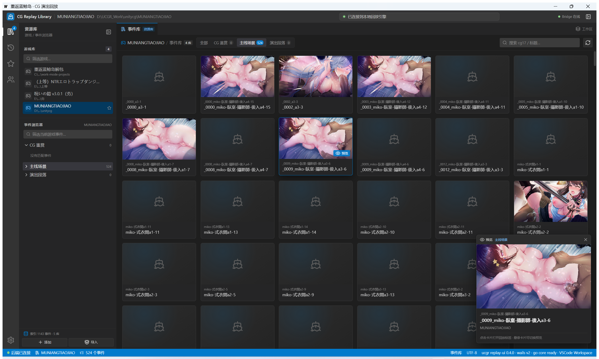
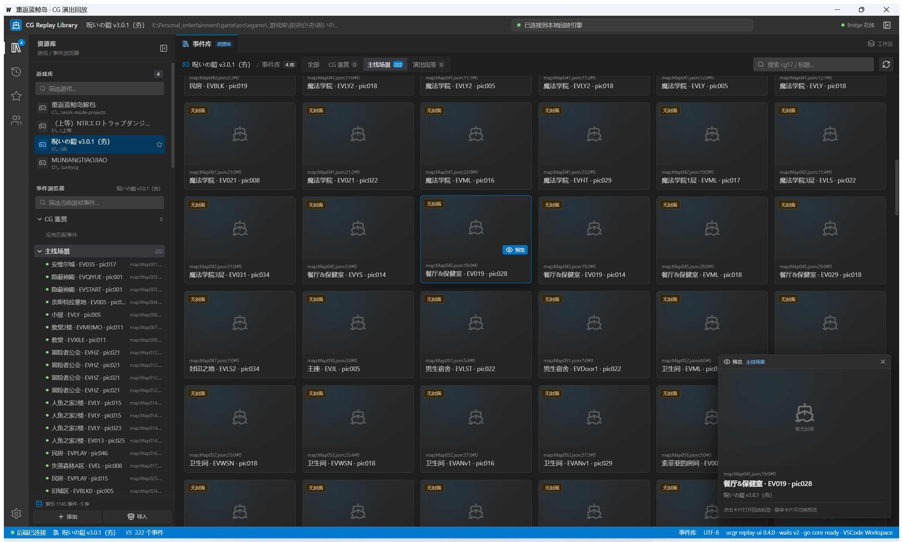

# 13. GitHub 项目管理（0.4.0）

## 一、当前状态（2026-11-13 已落库）

- GitHub CLI（gh）本机仍未装成：winget 下载报 `InternetOpenUrl() failed. 0x80072efd`；scoop/choco 不存在；直连 `github.com:443` 下载 zip 超时（本机仅 SSH 22 可达 GitHub）。gh 可用凭据：无（`GH_TOKEN` / `GITHUB_TOKEN` / `git config github.token` / cmdkey / `~/.config/gh/hosts.yml` 均无 token）。
- 改走 GitHub Actions 内置 `GITHUB_TOKEN`：workflow `.github/workflows/bootstrap-0.4.0.yml`（push 本文件到 main 或手动 `workflow_dispatch` 触发，权限只申请 `contents: read` + `issues: write`）。
- 结果：milestone **`0.4.0` = #1**（state open，open 4 / closed 0）已建；4 个 issue **#9 / #10 / #11 / #12** 全部落库并挂载 #1。
- 发布红线：未经用户明确许可，禁止打 tag、禁止 `gh release create`（docs/08）。

### Actions run 记录

| run | commit | 结论 | 说明 |
|---|---|---|---|
| [43450435061](https://github.com/Yiyiyyds3/cg-replay/actions/runs/43450435061) | `d0a94c8` | failure | `gh issue create --milestone` 传了 milestone 编号 `1`，issue 全部未建（milestone #1 已建成功） |
| [43452287099](https://github.com/Yiyiyyds3/cg-replay/actions/runs/43452287099) | `ae466fc` | success | milestone 改用名称 `0.4.0` + issue 去重改全量标题精确匹配（`grep -Fxq`），4 个 issue 一次建成 |

- 失败修复提交：`ae466fc27f44a94d0018bf5eaeaba95957822e4f`（`ci: 修复 issue 引导的 milestone 名称与去重判断`）。

## 二、落库方式

- 主路径（已跑通）：`.github/workflows/bootstrap-0.4.0.yml`，push 本文件到 main 即触发；无需本机 gh / PAT。
- 幂等：milestone 先查再建（按标题 `0.4.0` 匹配）；label 用 `gh label list` 判重；issue 用全量标题 `--state all --limit 200` + `grep -Fxq` 精确匹配去重。
- 关键坑：`gh issue create --milestone` 只认 **milestone 标题**，传编号（`1`）会整条失败且 milestone 本身已建成——首次 run 43450435061 即栽在这里。
- 备用路径：`tools/github-bootstrap.ps1`（幂等，先查再建），需本机 gh + PAT（repo + project 权限）：

```powershell
$env:GH_TOKEN = "<你的 GitHub PAT（需 repo + project 权限）>"
.\tools\github-bootstrap.ps1
```

## 三、四个 issue（已建）

| # | 标题 | 标签 | URL | 分支 | Merge commit |
|---|---|---|---|---|---|
| 9 | [Bug] 解包后 CG 分类错位与纯黑界面误判 | bug | https://github.com/Yiyiyyds3/cg-replay/issues/9 | fix/unpack-classify-black | e5ec406071f7af966b6115ecb01ffa4bdbe00e4a |
| 10 | [Bug] CG 预览图截取显示入场黑屏 | bug | https://github.com/Yiyiyyds3/cg-replay/issues/10 | fix/cover-frame | d3637372e41c6b62ca90d50fca2463152f7f8980 |
| 11 | [Feature] 回放点击互动与文本/音频 | enhancement | https://github.com/Yiyiyyds3/cg-replay/issues/11 | feat/click-av | 97269899a03698b4d719ce8b998f56bb8af0343d |
| 12 | [Design] 工作区与导航栏 VSCode 风格重构 | design | https://github.com/Yiyiyyds3/cg-replay/issues/12 | feat/vscode-ui | 96eecdcaf1d3ef057e2233f570d8a1581153deff |

四个 issue 均 state=open，milestone 均为 `0.4.0`（#1）。验收标准全文见各 issue 正文（与 docs/11 第二章一致）与 docs/12 验收报告。

## 四、对比链接

- 整体（0.4.0 起点 → 当前 main）：https://github.com/Yiyiyyds3/cg-replay/compare/d24709b...670b870
- 各 merge commit：`https://github.com/Yiyiyyds3/cg-replay/commit/<hash>`
- 补 PR 不可行：四个分支均已以 merge commit 并入 main，不硬造 PR；关联关系落在 issue 正文与评论。

## 五、里程碑与看板

- Milestone：`0.4.0` = **#1**（https://github.com/Yiyiyyds3/cg-replay/milestone/1），state=open，4 open / 0 closed，四个 issue 已全部挂载。
- 教训：`--milestone` 参数必须传标题 `0.4.0`；传编号 `1` 会报错并中断脚本（`set -euo pipefail`），导致 4 个 issue 全部未建。
- Project（看板 v2）：`cg-replay 0.4.0` 仍未建——`GITHUB_TOKEN` 无权创建 Project v2，需 PAT 后补；补建后把 #9~#12 加入为 item（列：Todo / In Progress / Done 自行拖动）。

## 六、导入链路端到端实测（2026-11-17）

**结论：AddGame 后端链路（含 `[fix-app] f32859b` 的导出 CG 库特例）实测通过，两条真实登记全部落库、UI 卡墙可见；UI 自动化点击「导入游戏」→ 系统目录弹窗环节存在一个待查异常（见 6.4）。**

### 6.1 构建产物

| 项 | 值 |
|---|---|
| 前端 | `tsc -b && vite build`，1647 modules，450.62 kB js |
| 桌面端 | `wails build -s`（v2.17.0），编译 6.308s |
| exe | `desktop\build\bin\cgreplay-ui.exe` |
| 大小 | **18,338,304 B**（旧版对照 18,333,696 B） |
| SHA256 | `CA25FC712B9762F8399D3CE869AF42166C59A556AF78BF1FE27EF76296E8687C` |

### 6.2 UI 自动化过程（System.Windows.Automation）

- UIA 定位主窗（`wailsWindow`）与「导入」按钮成功，`InvokePattern.Invoke()` 成功唤起系统目录选择弹窗（`#32770`，标题「选择游戏解包目录（含 raw\data\scenario 的那一层）」）——`[fix-ui] 4031215` 的入口按钮本身工作正常。
- 弹窗内部 UIA 树异常：`FindAll` 17 个 Edit 全是列表列头/搜索框，真正的文件名编辑框不可达，后续对按钮子树的批量查询抛 COM「无法识别的错误」；改用键盘输入路径 + Enter 的尝试中，**应用进程在无 WER 崩溃记录、errors.log 无新增的情况下退出**（复现 1 次；Wails 弹窗→扫描交互层问题，AddGame 链路本身被 6.3 证明无恙）。
- 按预案改后端等价验证：一次性 Go 测试直调 `App.AddGame`（不重定向 LOCALAPPDATA，写真实数据目录；跑完已删除，避免 `go test ./...` 意外写用户数据）。

### 6.3 后端等价验证输出（原文）

```
=== RUN   TestE2EImportRealNativeJunction
E2E-B OK: engine=rmmz scenes=222 cgs=0 chapters=0
E2E-B 登记项: id=g8350fe1118 title=呪いの鎧 v3.0.1（夯） engine=rmmz root=E:\Personal_entertainment\game\ero\egame\_游戏库\按评价\夯\呪いの鎧 v3.0.1（夯）
--- PASS: TestE2EImportRealNativeJunction (1.68s)

=== RUN   TestE2EImportRealExportedCGLibrary
E2E-A OK: engine=unity scenes=524 cgs=0 chapters=0
E2E-A 登记项: id=gb6d75e19d2 title=MUNIANGTIAOJIAO engine=unity root=D:\UCGR_Work\unitycg\MUNIANGTIAOJIAO
--- PASS: TestE2EImportRealExportedCGLibrary (0.03s)
```

### 6.4 UI 可视证据

- 导出 CG 库（MUNIANGTIAOJIAO，unity，524 事件）：



- 原生 junction 目录（呪いの鎧 v3.0.1（夯），rmmz，222 事件；卡片为「无封面」占位徽标、非黑块，该目录未产出封面缩略图）：



侧栏游戏库由 2 条变 4 条（UIA 按钮树原文：`重返蓝鲸岛解包 | （上等）NTRエロトラップダンジョン | 呪いの鎧 v3.0.1（夯） | MUNIANGTIAOJIAO`），主区卡片墙非空态，底栏「索引 1143 事件 · 5 库」。

### 6.5 数据目录核验

- `%LOCALAPPDATA%\cgreplay-ui\errors.log`：**4722 B，与测试前基线完全一致，0 新增报错**。
- `games.json`：4 条登记，两条新增均在——`g8350fe1118（rmmz，呪いの鎧 v3.0.1（夯））`、`gb6d75e19d2（unity，MUNIANGTIAOJIAO）`。
- 两条测试登记按约定保留在真实数据目录（如实报告，未清理）。
