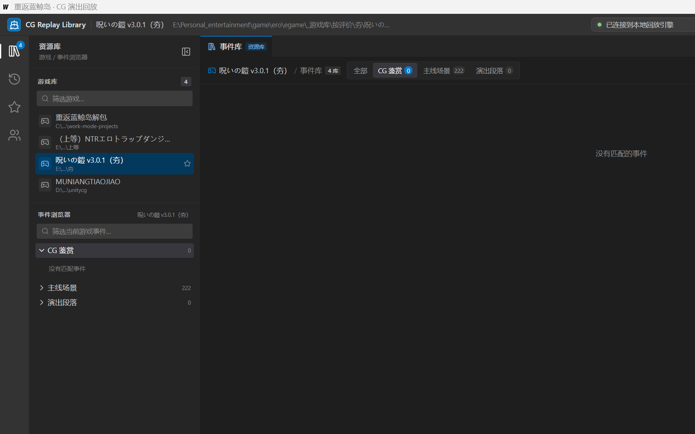

# 18 · PR #8 合并到 main 并全量验证记录

> 日期：2026-11-18　操作人：小鲸（cabf2670 会话）
> 集成分支 `origin/integrate/pr8-spine` = `79421a1`（基于 `3a36183`，纯快进）已推送到 `main`，随后在临时 worktree（`ucgr-wt-verify2`，分支 `verify/pr8-merged`）上做合并后全量验证与 exe 实测。

## 一、快进与同步

| 项 | 结果 |
| --- | --- |
| `git merge-base --is-ancestor origin/main origin/integrate/pr8-spine` | `FF_OK` |
| `git push origin integrate/pr8-spine:main` | `3a36183..79421a1 integrate/pr8-spine -> main` |
| 主检出 `git pull --ff-only origin main` | 被主检出未提交的 `desktop/frontend/wailsjs/go/models.ts` 本地改动挡住（Aborting），主检出**保留原状（3a36183）未动**；验证改在新建临时 worktree `E:\...\ucgr-wt-verify2`（`git worktree add ... -b verify/pr8-merged origin/main`）上完成，未跟踪文件（docs/16、docs/17、reports、tools/review-*）全部未触碰。 |

## 二、冲突文件 10 个与逐类解法摘要（取自 79421a1 commit message）

两边功能都保留：
1. `cmd/ucgr/main.go`：imports 并集（media/renpy+nexas/nitro/nscript/scn）；events 命令 --engine 覆盖 + DetectConvention 兜底；show switch 保留 .scn/.ast/.cst/.bs/NeXAS/Nitro/NScripter 分支并新增 media/renpy 分支。
2. `internal/adapter/convention.go`：DefaultSCN/Artemis/BGI/CatSystem2/NScripter/Unity/NeXAS/Nitro + autoScenarioEngines（main）与 DefaultRenPy/DefaultMedia（分支）并集；ConventionByEngine 补 renpy/media 两 case。
3. `internal/library/library.go`：scanWith 保留 main 的 switch 分派并新增 media/renpy 两 case（约定文件 Merge 与按引擎分派并存）。
4. `internal/library/library_test.go`：TestScanGenericKAG 与 TestScanHonorsConventionFile 都保留；后者适配合并后「0 可解析脚本报错」行为（01a 兜底场景）。
5. `internal/adapter/rmmz/rmmz_test.go`：scriptCG 三测（main：TestScriptCGName / TestLocateCGSet / TestSegmentsScriptCG）与诊断两测（分支）都保留。
6. `desktop/app.go`：GameCover 取 main 的 cover 缓存重构；保留分支的 SaveSpineThumb（适配 coverCachePath+meta）、gameByID、readGameCover；删 saveRatioCrop（main 用 cover.CropFit）。
7. `desktop/cover_test.go`：缓存版本/layerShowRefs/pickDirectImage（main）+ TestReadGameCover（分支）都保留。
8. `desktop/frontend/wailsjs/go/models.ts`：ReplayDTO 保留 mode/modes/dialogue 且 spine 用 convertValues(SpineDTO)。
9. `EventGrid.tsx`：取 main（VSCode 外壳不回退）。
10. `Replay.tsx`：取 main；换装能力放 SpineStage 内部（skin prop 可选，未传时组件自控渲染换装面板）。

## 三、三块新能力确认（行号）

| 能力 | 位置 | 证据 |
| --- | --- | --- |
| ① unity_cg_export `--auto` | `tools/unity_cg_export.py` | `ap.add_argument("--auto", ...)` 定义于 **L688**（docstring L231，L732/735/737 为校验与输出） |
| ② unpack Convention 合并 | `internal/unpack/unpack.go` | **L540** `conv = existing.Merge(conv)`（`grep -rn 'Merge(' internal/unpack/*.go` 唯一调用点） |
| ③ SpineStage 换装 | `desktop/frontend/src/components/SpineStage.tsx` | **L84** `const skins = spine.skins ?? []`、**L85** `showSkinPanel = skin === undefined && skins.length > 1`、**L272** `skins.map(...)` 渲染换装面板 |

## 四、合并后全量验证（均在 79421a1 内容上）

### 1. 根模块
- `go build ./...`：EXIT=0
- `go vet ./...`：EXIT=0
- `go test ./...`：EXIT=0，31 个含测试包全部 ok，0 FAIL（rmmz/asset/replay/library/unpack 均在列）。
- 重点包点名（-v 全 PASS）：
  - `internal/adapter/rmmz`：TestScriptCGName、TestLocateCGSet、TestSegmentsScriptCG（scriptCG 三测）
  - `internal/asset`：包整体 ok
  - `internal/replay`：TestCheckEventVisibilityBlackIntroThenCG / TestCheckEventVisibilityUsesWaitDurations / TestCheckEventVisibilityAllBlack（visibility）
  - `internal/library`：TestScanGenericKAG、TestScanHonorsConventionFile（两个都在）
  - `internal/unpack`：TestExtractPreservesUserConvention、TestExtractKeepsBrokenConvention

### 2. desktop
- 前置：`npm ci`（145 packages，exit 0）+ `npm run build`（tsc -b && vite build，1647 modules，零 TS 错误，exit 0）
- `go build ./...` EXIT=0；`go vet ./...` EXIT=0；`go test ./...` EXIT=0（ok ucgr/desktop）
- 点名（-v 全 PASS）：TestAddGameExportedCGLibrary、TestAddGameNativeRMMZ、TestAddGameFakeDirActionableError（AddGame 三测）、TestReadGameCover、TestLoadSpineAssets、TestLoadSpineAssetsBinarySkel、TestLoadSpineAssetsRejectsTraversal（Spine 三测）

## 五、exe 重建与实测

- `wails build -s`（wails v2.17.0，skip frontend 复用 dist）：Built in 11.896s
- exe：`desktop/build/bin/cgreplay-ui.exe`
  - 大小：**18,599,936 bytes（17.74 MB）**
  - SHA256：`52D35BE41F2F0A5D7020A41859C70E1E689E3A1F07A5756440E8157C8F671964`
- 启动实测（最大化，5s 后截屏）：
  -  —— `docs/assets/pr8-merged-smoke.png`：VSCode 外壳（标题栏/活动栏/侧栏/标签页「事件库·资源库」/面包屑）未回退；游戏库 4 个游戏（重返蓝鲸岛解包、NTRエロトラップダンジョン、呪いの鎧 v3.0.1、MUNIANGTIAOJIAO）正常显示；无错误横幅；右上「已连接到本地回放引擎」。
  - **Spine 换装面板未实机验证**：games.json 登记 4 款游戏 engine 分别为 rmmz×2 / unity×1 / 未标注×1，无任何 SPR（spine）游戏，libraries/*.json 中 spine 提及数为 0——无 Spine 语料，`docs/assets/pr8-spine-skins.png` 未拍摄，换装能力仅有单测（TestLoadSpineAssets 三测）+ 代码证据（SpineStage.tsx L84/L85/L272）。
- 结束进程后 `%LOCALAPPDATA%\cgreplay-ui\errors.log`：最后写入时间仍为 2026-11-16 23:38:15，**本次运行零新增 Error**。

## 六、遗留风险

1. EventGrid.tsx / Replay.tsx 取 main：换装入口不在事件网格/回放页，只在 SpineStage 内部（skin prop 可选、未传时自控渲染面板）——后续若要在回放页直接换装需要补 prop 传递。
2. SpineStage.tsx 取分支并内部兼容：与 main 侧 UI 的联动（如从 Replay 页跳转）未经实机验证。
3. rmmz 自动合并后靠测试守：scriptCG 三测 + 诊断两测全绿，但真实 RMMZ 语料回归依赖人工抽检（本次 smoke 未逐游戏点开）。
4. 主检出仍停在 3a36183（models.ts 本地改动未处理，属他人工作区状态，本次未动）；远端 main 已是 79421a1 + 本落档提交。
